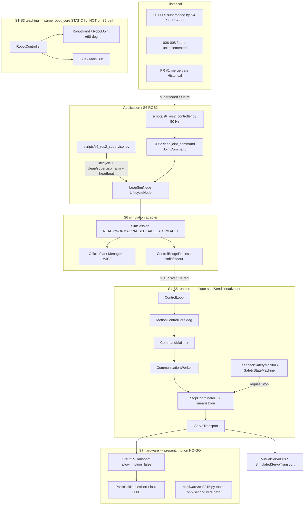
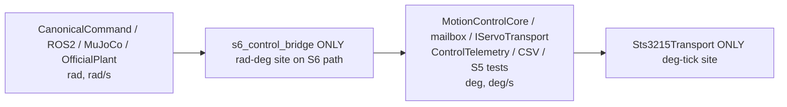
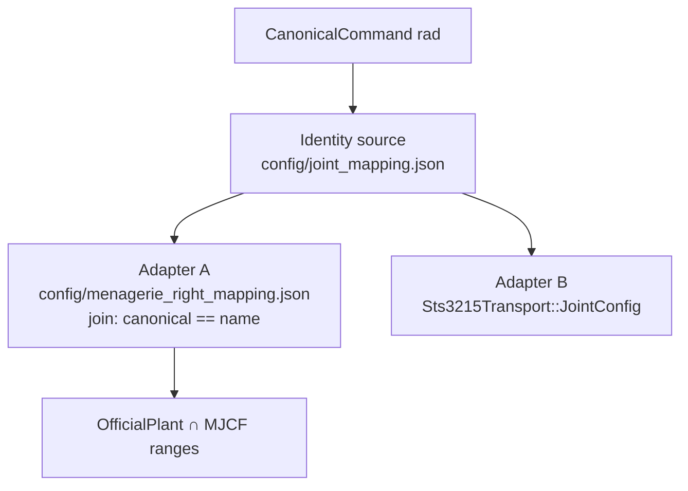
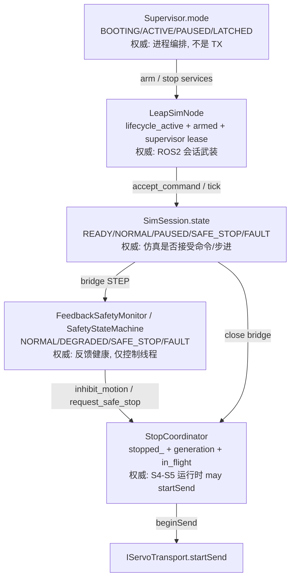

# S7-00 Contract Convergence for the LEAP dexterous-hand stack

| 字段 | 值 |
|---|---|
| Document ID | `S7-00` |
| Title | 契约收敛：单一 16-DOF 类型、单一映射、S4–S5 运行时唯一 `mayStartSend` 谓词 |
| Author | dexterous-hand maintainers（学习项目；S7-00 合同起草） |
| Date | 2026-11-07 |
| Status | **Frozen / Implemented**（2026-11-07 评审 0 open issues；PR-2～PR-5 已按本合同落地。S6-R01 软件测试已写入 `s6-ros2.yml`，需 Jazzy CI 通过后才可把 S6-R01 标为关闭） |
| Audience | 本仓库后续实现与审查（单人学习项目） |
| Baseline | `main` 上 S5 验收 `docs/acceptance/s5_stage_acceptance_2026_11_05.md`、S6 验收 `docs/acceptance/s6_stage_acceptance_2026_11_05.md`（S6 基线 commit `1ac4b714` / PR #35；文档提交 `c472bcb`） |
| Language | 中文叙述；代码标识符、路径、类型名、topic 名保持 English |

---

## Overview

当前仓库已经有一条可运行的 S6 仿真闭环（ROS2 `JointCommand` → `LeapSimNode` / `SimSession` → `s6_control_bridge` stdin/stdout → S5 `ControlLoop` / `MotionControlCore` / `StopCoordinator` → Menagerie MJCF），以及仍留在同一 `robot_core` STATIC 库里的 S1–S3 教学栈。但**应用层契约是分裂的**：文档仍停留在 Python-first / Design 001–008 / “S4 未实现”；ROS2 命令用 Menagerie 关节名而 `config/joint_mapping.json` 用另一套名字；C++ 限位写死 `±90 deg`，Python `OfficialPlant` 只好再与 `±π/2` 求交；`epoch` 在 unmanaged 路径进程启动恒为 0、managed 路径 `next_epoch = 1`，都不能隔离跨进程 DDS 重放（S6-R01）；五套状态词汇同名不同义。

本设计冻结 S7 之前的**契约收敛**，不重写 S5/S6 控制环：

1. 先改架构文档，使之与真实 S1–S6 代码一致。
2. 应用面只承认一种 16-DOF 类型：弧度、canonical 关节名、顺序 `0..15`，并携带 `session_id`。
3. 一份身份表 + 两个后端适配器（Menagerie MJCF、STS3215）。
4. S4–S5 **运行时路径**上唯一允许启动 `IServoTransport::startSend` 的线性化点仍是 `StopCoordinator::beginSend`。Python/ROS2 只能武装会话。仓库里另有一条默认关闭的 tools 串口路径（`hardware/sts3215.py`），不得接入运动 PR。
5. 实现按小 PR 增量落地：文档 → 类型 → 映射加载 → `session_id`（PR-4a）→ canonical 名（PR-4b）→ 协议黄金向量。STS3215 运动使能、物理 E-stop、`ros2_control`、in-process C++ ROS2 **不在本系列**。

**S6-R01 在本文件中尚未关闭。** 仅当 PR-4a 的 unmanaged 进程重启注入测试写入 `.github/workflows/s6-ros2.yml` 并在 CI 通过后，才允许把 S6-R01 标为软件条件关闭。

---

## Context / problem

仓库的**真实运行时路径**（S6 已于 2026-11-05 阶段验收通过）是：

```text
ROS2 controller (Python, 50 Hz)
  leap_interfaces/msg/JointCommand  (rad, epoch, sequence, 16 Menagerie names)
        |
LeapSimNode / SimSession (READY / NORMAL / PAUSED / SAFE_STOP / FAULT)
  validate names / limits / TTL / epoch
        |
stdin/stdout text bridge  cpp/examples/s6_control_bridge.cpp
  rad <-> deg
        |
C++ S5 core
  ControlLoop -> MotionControlCore -> CommandMailbox
  -> CommunicationWorker -> StopCoordinator -> IServoTransport
        |
OfficialPlant (Menagerie MJCF) -> 5 x mj_step(2 ms)
```

同一 STATIC 库 `robot_core`（`cpp/CMakeLists.txt`）还包含**不在 S6 路径上**的教学栈：`IBus::send(id, deg)`、`MockBus`、同步 `RobotController`、`RobotHand ±90 deg`。`SafetyStateMachine` 是例外：S5-06 `FeedbackSafetyMonitor` 内部持有一台。

问题不是“缺控制环”，而是**契约未收敛**，后续 S7 硬件 PR 会各自发明：

| 分裂点 | 现状 | 后果 |
|---|---|---|
| 文档 vs 代码 | `docs/architecture/system_architecture.md` 仍写 Python-first、Design 001–008、PR #1 merge gate、ROS2 未实现；`cpp/README.md` / `cpp_control_architecture.md` 停在 S1–S3 并声称 S4 未实现；`simulation/README.md` 与 `docs/designs/s6_02_official_leap_ros2.md` 仍写 `JointState` + `frame_id` epoch（S6-R07） | 实现者按过期图施工 |
| 关节身份 | `config/joint_mapping.json` 用 `index_mcp_side` + URDF `"0".."15"`；`config/menagerie_right_mapping.json` 用同一 canonical 名但 ROS2 命令发 `if_rot` 等 MJCF 名；`JointCommand.msg` 注释写 “Menagerie right-hand joint mapping” | 应用层没有单一名字空间 |
| 单位 | ROS2 / MuJoCo / `OfficialPlant` = rad；`MotionControlCore` / `IServoTransport` / `RobotHand` / S5 telemetry CSV = deg | 可接受，但未写成冻结边界 |
| 限位 | `MotionJointConfig` 默认 `min_deg=-90, max_deg=90`（`MotionControlCore.hpp`）；`OfficialPlant.__init__` 因该默认值把 MJCF 限位与 `±π/2` 求交；`MotionControlCore::step` 对**超限实测**返回 false 并触发 `requestStop` | 官方模型真实行程被静默裁剪；JSON 与 C++ 不同步会锁存 STOP |
| 会话 | unmanaged：`SimSession.epoch = 0` 每个新进程；managed：`LeapSimNode.next_epoch = 1`。`/leap/joint_command` 为默认 VOLATILE depth 10。`epoch+sequence` 只隔离**同进程** pause/reset | S6-R01：仍运行的旧发布者 + 新仿真进程可重用 epoch 0 或 1 |
| 安全状态 | 五套词汇：`Supervisor.mode`、`LeapSimNode.armed`、`SimSession.state`、`SafetyStateMachine`、`StopCoordinator` | “谁说了算能不能动”不明确 |
| 协议双份 | `hardware/sts3215.py` 与 `cpp/include/robot/bus/Sts3215Protocol.hpp` 各自维护编解码 | 向量漂移风险 |
| 硬件门禁 | `Sts3215Transport::Config.allow_motion = false`；`joint_mapping.json` `calibration.status = "not_calibrated"` | 正确，但映射加载器尚未把二者连成谓词 |
| 第二写路径 | `hardware/sts3215.py` `STS3215Bus.set_torque` / `write_goal_position_ticks` 不经过 `beginSend` | tools 默认不调用；不是运行时 TX 门 |

已知且**不得假装已关闭**的风险：S6-R01/R02/R03，H-01/H-02/H-03。S7 带载运动仍是 **NO-GO**。本设计规定如何用 `session_id` **准备**关闭 S6-R01，但在 PR-4a 的 unmanaged CI 测试落地前不得把 S6-R01 标为已关闭。不关闭 R02/R03/H-*。

---

## Background & Motivation

S1–S3 是教学用同步控制器（`RobotController` 阻塞 `IBus::send`）。S4 把控制与通信拆成 `ControlLoop` / `CommunicationWorker` / `CommandMailbox` / `FeedbackBuffer`。S5 在此之上加上 TX 线性化（`StopCoordinator`）、真实线程（`RealtimeExecutor`）、STS3215 传输、反馈分片与安全、位置外环 PD。S6 用**进程外文本桥**把该核心接到 MuJoCo + ROS2 Jazzy，避免 pybind 与 `ros2_control`。

文档没有跟着这条路径更新。若 S7 直接“统一架构”，常见失败模式是：把教学 `IBus` 接到真总线、把 ROS2 节点直接 `startSend`、把 C++ 核心改成弧度从而重写 S5 测试、或用 CI 21/21 当作硬件安全证明。

本阶段的动机是：**先把合同写死，再做薄适配器。** 现有 S5/S6 测试继续当回归门。学习项目、单开发者，PR 必须可独立合并。

---

## Goals

1. **架构基线重写（仅文档）**：一张与 `main` 一致的系统图。明确标注 S1–S3 教学、S4–S5 运行时、S6 仿真适配、S7 硬件（未使能）。`docs/designs/README.md` 中 **001–005 标为 superseded**（已被 S4–S6 + 本合同取代）；**006–008 标为 future / 本系列不实现**（MediaPipe、recording/replay、硬件标定与物理运动仍未做）。PR #1 merge gate **保留为 Historical 横幅，不删除史实**。`docs/designs/s6_02_official_leap_ros2.md` 加 Superseded 横幅，指向 S6-03 `JointCommand`。实现记录指向 `docs/designs/s4_*.md`、`s5_*.md`、`s6_03`/`s6_04` 与两份 acceptance。
2. **Canonical 16-DOF 合同**：应用面位置一律 radian、canonical 名、顺序 `0..15`。类型含 `stamp`、`session_id`（每进程启动唯一）、`epoch`、`sequence`。PR-2 头文件不依赖 `JointTable`。
3. **映射合同**：`config/joint_mapping.json` 的 16 个 `name` + `hardware_id` 是身份源。Menagerie 与 STS3215 只是后端列。发现路径冻结为环境变量，**禁止相对可执行文件查找**。C++ `MotionControlConfig` 在所有 `s6_control_bridge` 用户上从配置加载限位。未标定硬件拒绝普通运动。
4. **安全谓词**：S4–S5 运行时路径上唯一 `startSend` 线性化点是 `StopCoordinator::beginSend`。Python/ROS2 拥有 session/arming/lease，但不能旁路。冻结五套词汇对照表，不合并实现。物理 E-stop / torque-off 明确排除。
5. **STS3215 单源黄金向量**（本系列靠后 PR）：`hardware/sts3215.py` 与 `Sts3215Protocol` 共享 packet 向量。Python 保持 tools-only。
6. **保留 `s6_control_bridge` stdin/stdout**。不在本系列换成 pybind / `ros2_control` / in-process C++ ROS2。

## Non-goals

- 重写 `ControlLoop::tick`、`MotionControlCore::step`、`CommunicationWorker`、轨迹/PD/限幅算法。
- 把 C++ 运动核心从 deg 改成 rad。
- 实现 S7 真实运动使能、扭矩写入、物理 E-stop、独立 MCU 看门狗。
- 关闭 S6-R02（supervisor 心跳无身份）、S6-R03（lease 未测 worst-case）、H-01/H-02/H-03。
- 在 PR-4a 的 unmanaged CI 测试落地前声称 S6-R01 已关闭。
- 引入微服务、以 SROS2 作为本系列 blocker、重写 MuJoCo、引入 `ros2_control` / `hardware_interface`。
- 在本系列实现 MediaPipe 重定向、LeRobot/HDF5、Windows COM 串口后端（006–008 仍是未来项）。
- 合并或删除 S1–S3 教学 API（`IBus` / `RobotController` / `RobotHand`）。它们继续存在，但文档标明 **not on the S6 path**。
- 把 CI 绿当作硬件安全证明。
- 在本系列从 S6 桥构造 `Sts3215Transport`，或改写仓库内真实 `config/joint_mapping.json` 的 `calibration.status`。

---

## Current behavior / reuse plan

### 必须保留并回归的实现

| 组件 | 路径 | 复用方式 |
|---|---|---|
| S5 运行时 | `cpp/include/robot/runtime/S4Pipeline.hpp` `ControlLoop` / `CommunicationWorker` | 不改控制语义；新代码只 `setTargets`（deg） |
| 运动核心 | `MotionControlCore`，单位 deg / deg_s | 内部单位冻结为 deg；**内部不做 rad 换算** |
| TX 门 | `StopCoordinator::beginSend` | S4–S5 运行时路径上**唯一** `startSend` 线性化点 |
| 传输 | `IServoTransport::startSend/finishSend/read`；`VirtualServoBus`；`Sts3215Transport`（`allow_motion=false`） | 硬件写入仍默认关；本系列 S6 桥不构造 `Sts3215Transport` |
| 反馈安全 | `FeedbackSafetyMonitor` + 内部 `SafetyStateMachine` | 继续只在控制线程 `evaluate`，经 `requestStop` 作用到 TX 门 |
| S6 桥 | `cpp/examples/s6_control_bridge.cpp` + `simulation/s6_mujoco_bridge.py` `ControlBridgeProcess` | 保留文本协议；S6 路径上**唯一** rad↔deg 站点。PR-3：Python 启动子进程时注入 `LEAP_*`（见 §3.1） |
| 仿真会话 | `OfficialPlant` / `SimSession`（`simulation/s6_official_bridge.py`） | 保留 READY/NORMAL/PAUSED/SAFE_STOP/FAULT |
| ROS2 | 唯一 ament 包 `ros2_ws/src/leap_interfaces`；节点是 Python 模块 | PR-4a 扩展 `session_id`；PR-4b 改名字 |
| 命令校验 | `simulation/s6_command_contract.py` `validate_command` | 增加 `session_id` 与机器可读拒绝码 |
| 映射文件 | `config/joint_mapping.json`、`config/menagerie_right_mapping.json` | 身份源 + 适配器；先加一致性测试，不强制合并 |
| Python 协议工具 | `hardware/sts3215.py`、`scan_sts3215.py`、`calibrate_zero.py` | **第二写路径**，tools-only，默认不使能扭矩；运动 PR 不得调用 |
| 测试门 | 现有 S5 CTest + `S6BridgeProtocolTest` / `S6MuJoCoSmokeTest` / `S6OfficialModelTest` + `tests/test_s6_*.py` + ROS2 integration | **每个实现 PR 必须保持这些绿**；PR-3：CMake 在每个已注册的 S6 `add_test` 旁设 `ENVIRONMENT`；Python 生成桥进程时自行补 `LEAP_PROJECT_ROOT` |

### 明确不复用为运动路径的代码

- `IBus` / `MockBus` / `RobotController`：教学同步路径。S6/S7 运动不得调用 `IBus::send`。
- `simulation/leap_hand_model.py` 的 URDF 重排：服务旧 URDF 子模块，**不是** S6 Menagerie 路径。
- `RealtimeExecutor`：wall-clock 双线程。S6 仿真继续用仿真时钟步进，不在桥进程里启动。
- `robot/robot_core.hpp`：仅 S1–S3 兼容聚合头，新代码包含具体模块头。本系列不把 S4–S5 塞进该头。
- `ControlLoop` 在未调用 `enableMotionControl` 时的 **S4 直通限位 `±90.f` deg**：遗留兼容路径，不是第三套单位政策。S6 桥必须走 `enableMotionControl`。

### 平台

| 平台 | 支持范围 |
|---|---|
| Windows 开发机 | 文档、C++ `robot_core` 编译（`PosixHalfDuplexPort` 在非 Linux 上为空或编译失败是已知约束）、Python 单测、无真实串口 |
| Linux + ROS2 Jazzy | 真实 DDS、lifecycle supervisor、S6 integration（`.github/workflows/s6-ros2.yml`，`ubuntu-24.04` + `ros:jazzy-ros-base`） |
| Linux 串口 | `PosixHalfDuplexPort`：1 Mbps 8N1 + TEMT ioctl；无 TEMT 的 USB-TTL **失败关闭** |
| Windows COM | **不存在**；本系列不添加 |

---

## Hardware dependencies

本系列**不使能**任何真实关节运动。

| 项 | 状态 |
|---|---|
| 物理 E-stop / 断扭矩 / 独立看门狗 | 不存在（H-01）；本系列不实现假 torque-off |
| Linux `PosixHalfDuplexPort` + TEMT | 代码存在；未在目标适配器上验收（H-02） |
| Windows COM | 不存在 |
| 16 路 ID / 方向 / 零位 / 机械限位 | `joint_mapping.json` 为未标定占位（H-02） |
| 16 路总线时序 | 未测（H-03） |
| Menagerie MJCF 网格 | `python3 -m simulation.fetch_leap_menagerie` 下载；**不在 git 中**，限位黄金夹具在 fetch 后生成并提交 |
| ROS2 | 仅 Linux Jazzy CI；节点不是 ament 包 |

只读 probe 允许在电气安全前提下使用；不得从本系列任何测试改写真实 `calibration.status`。

---

## Key Decisions

1. **文档先于代码。** 第一个可合并 PR 只改 `docs/`（含 `s6_02` 横幅与 001–008 处置）。不在同一 PR 改控制代码。

2. **C++ 运动核心保持 deg。** 换算站点冻结：S6 路径上**只有** `s6_control_bridge` 做 rad↔deg；硬件路径上**只有** `Sts3215Transport` 做 deg↔tick。Telemetry/CSV/S5 测试保持 deg。Canonical/ROS 保持 rad。`MotionControlCore` 内部无单位转换。

3. **身份 = canonical 名 + `canonical_id` 0..15。** 16 个名字冻结为 `joint_mapping.json` 的 `joints[].name`。ROS2 名字切换发生在 **PR-4b**，不是 PR-3。PR-4a 期间 `JointCommand.joint_names` 仍为 MJCF 名。

4. **两份 JSON 暂不合并。** 身份源：`config/joint_mapping.json`。仿真适配：`config/menagerie_right_mapping.json`。`OfficialPlant` 必须**两份都加载**，按 `canonical == name` 连接，不得只靠数组下标。

5. **`session_id` 是进程 boot nonce，不是 epoch。** 在 `LeapSimNode.__init__` 对 managed **与** unmanaged 各生成一次。Controller 必须像对待 `/leap/sim_epoch` 一样采纳 `/leap/sim_session`。同进程 reset 不轮换。**不得在 PR-4a unmanaged CI 测试之前声称 S6-R01 已关闭。**

6. **`StopCoordinator::beginSend` 是 S4–S5 运行时路径上的唯一 TX 线性化点。** Python `armed` 不是 TX 许可。`hardware/sts3215.py` 是默认关闭的第二写路径；S6/S7 运动 PR 不得调用它。`MotionGateView` 只读，不能授权 `startSend`。

7. **五套状态词汇不合并实现。** 权威即下文五列表。禁止再说“三套状态机”。

8. **所有 `s6_control_bridge` 用户（含 S6-01 surrogate）加载 JSON 限位。** S5 单测默认 `MotionControlConfig{}` 仍为 `±90 deg`。`OfficialPlant` 删除硬编码 `±π/2`，与 canonical `limit_rad` ∩ MJCF 求交。植物 `apply` 拒交外命令；C++ 对超限**实测**锁存 STOP。提交 16 路最终 `[low,high]` 黄金夹具。保持 `low < 0 < high` 不变量。

9. **未标定 ⇒ 禁止普通运动。** `allow_motion = operator_allow_motion && calibration == Calibrated`。本系列所有调用点 `operator_allow_motion=false`。非零 `zero_offset_rad` 不得把 `allow_motion` 翻成 true。

10. **Python STS3215 永不进入运动路径。** 共享黄金向量，不共享运行时总线对象。

11. **stdin/stdout 桥保留到 S7+。** 桥握手不加 `SESSION`；S6-R01 在 DDS 层处理。

12. **CI 绿 ≠ 硬件安全。**

13. **映射发现顺序（C++ 无相对可执行文件回退）：** 桥进程只认 (1) `LEAP_JOINT_MAPPING`；(2) `${LEAP_PROJECT_ROOT}/config/joint_mapping.json`。两者都缺或不可读 ⇒ C++ fail-closed，不握手 `READY`，不回退 `±90`。禁止 C++ 搜索 executable / cwd。Python **生成桥的进程**（`ControlBridgeProcess` 与 `test_s6_bridge_protocol.py`）必须 `copy os.environ`，若两个 `LEAP_*` 都未设置则写入 `LEAP_PROJECT_ROOT=Path(__file__).resolve().parents[1]`（即 `s6_mujoco_bridge.PROJECT_ROOT`）。这样 ROS2 CI / README 手工启动不必 `export`。CMake 在每个已注册的 S6 `add_test` **旁边**设 `ENVIRONMENT`（皮带+吊带）。空环境直接跑 `./s6_control_bridge` 仍必须失败。

14. **命令拒绝码是合同的一部分**，在 command-contract（PR-2 类型 + PR-4a 接线）落地，不是可选日志。

---

## Proposed Design

### 1. 架构基线（文档 PR 必须画出的当前系统）



**分层标签（文档必须使用这些词，避免再发明）：**

| 标签 | 含义 | 权威代码 |
|---|---|---|
| S1–S3 teaching | 同步教学核心 | `RobotController`, `IBus`, `RobotHand` |
| S4–S5 runtime | 异步控制/通信/安全/STS 协议 | `S4Pipeline.hpp`, `RealtimeExecutor`, `StopCoordinator`, `Sts3215*` |
| S6 sim adapter | Python 植物 + ROS2 + 文本桥 | `s6_official_bridge.py`, `s6_ros2_node.py`, `s6_control_bridge.cpp` |
| S7 hardware | 真实总线；本系列只读准备，运动 NO-GO | `sts3215_readonly_probe`, `Sts3215Transport` |

文档修改清单见 PR-1。

### 2. Canonical 16-DOF 合同

#### 2.1 身份与顺序

冻结的 16 个 canonical 名（来源 `config/joint_mapping.json` `joints[].name`，按 `hardware_id` 0..15）：

```text
 0 index_mcp_side        1 index_mcp_forward     2 index_pip       3 index_dip
 4 middle_mcp_side       5 middle_mcp_forward    6 middle_pip      7 middle_dip
 8 ring_mcp_side         9 ring_mcp_forward     10 ring_pip      11 ring_dip
12 thumb_cmc_side       13 thumb_cmc_forward    14 thumb_mcp     15 thumb_ip
```

最长名 `middle_mcp_forward` = 18 字符。C++ 定长缓冲：**最多 31 个有效字符 + NUL**（`char[32]`）。比较用 `strncmp(..., 32)`，要求写入方保证 NUL。

- 应用向量 `q[i]` 对应 `canonical_id == i`。
- Menagerie 名与 URDF 编号**不得**出现在 `CanonicalCommand.names` 中。ROS2 `JointCommand.joint_names` 在 PR-4b 之前仍为 MJCF 名（见 PR Plan）。
- 常量：`robot::contract::kCanonicalDof = 16`，与 `kServoCount` / `kJointCount` 同值。可用别名，不强制全局改名。

#### 2.2 单位边界（完整表）



| 边界 | 单位 | 转换点 |
|---|---|---|
| `JointCommand`、`CanonicalCommand`、`OfficialPlant`、MuJoCo `qpos`/`qvel`、ROS2 `/joint_states` position/velocity | rad, rad/s | 无 |
| `s6_control_bridge` STEP/OK 文本 | rad | 桥内 `kRadToDeg` / `kDegToRad` |
| `ControlLoop::setTargets`、`CommandMailbox`、`IServoTransport` | deg | 禁止再转 |
| `MotionControlCore` / limiter / planner | deg, deg/s, deg/s² | **内部无转换** |
| `ControlTelemetryFrame`、S5 CSV、`scripts/plot_s5_telemetry.py` | `target_deg` / `command_deg` / `measured_deg` | 保持 deg；禁止“帮忙”改 rad |
| S5 CTest（含 `S5MotionControlTest`） | deg | CanonicalCommand 夹具**不得**出现在这些测试里 |
| `Sts3215Transport` 寄存器 | ticks | **唯一** deg↔tick |
| Python `ticks_to_radians` / `radians_to_ticks` | rad | tools-only |
| `ControlLoop` 未启用 motion 时的 `±90.f` 裁剪 | deg | **S4 遗留直通**；S6 必须 `enableMotionControl` |

换算：`deg = rad * 180 / π`，`rad = deg * π / 180`。核心存储 `float` deg；Canonical 为 `double` rad。桥处 `static_cast<float>(rad * 180.0 / π)`。可接受误差远小于 1 tick（≈0.088 deg）。非有限值在进入核心前拒绝。

#### 2.3 类型布局（PR-2：无 `JointTable`）

Python（升级 `simulation/s6_command_contract.py`，或薄模块 `simulation/canonical.py` 被其 import）：

```python
COUNT = 16
CANONICAL_NAMES: tuple[str, ...]  # 冻结 16 名，与 §2.1 完全一致
NAME_MAX = 31

class CommandReject(str, Enum):
    STALE_SESSION = "stale_session"
    ZERO_SESSION = "zero_session"
    STALE_EPOCH = "stale_epoch"
    BAD_SEQUENCE = "bad_sequence"
    BAD_NAMES = "bad_names"
    NON_FINITE = "non_finite"
    LIMIT = "limit"
    TTL = "ttl"

class CommandContractError(ValueError):
    def __init__(self, code: CommandReject, message: str) -> None:
        super().__init__(message)
        self.code = code.value

@dataclass(frozen=True)
class CanonicalCommand:
    stamp_us: int
    session_id: int        # uint64, 0 invalid
    epoch: int
    sequence: int
    names: tuple[str, ...] # 16 unique **canonical** names（允许乱序）
    positions: tuple[float, ...]  # rad

@dataclass(frozen=True)
class CanonicalState:
    stamp_us: int
    session_id: int
    epoch: int
    sequence: int
    names: tuple[str, ...] # 固定 canonical 顺序
    positions: tuple[float, ...]
    velocities: tuple[float, ...]
```

`validate_command` 接受 `expected_names: Sequence[str]`（PR-4a 仍传 MJCF `plant.names`；PR-4b 改传 `CANONICAL_NAMES`）。拒绝时抛 `CommandContractError`，**在更新 `last_sequence` / target 之前**。`session_id == 0` → `ZERO_SESSION`。

C++ 头 `cpp/include/robot/contract/CanonicalCommand.hpp`（**不得** `#include` mapping / `JointTable`）：

```cpp
namespace robot::contract {
constexpr std::size_t kCanonicalDof = 16;
constexpr std::size_t kCanonicalNameMax = 31; // + NUL in char[32]
constexpr char kCanonicalNames[kCanonicalDof][32] = {
    "index_mcp_side", "index_mcp_forward", /* ... thumb_ip */
};
struct CanonicalCommand {
    std::uint64_t stamp_us = 0;
    std::uint64_t session_id = 0;
    std::uint64_t epoch = 0;
    std::uint64_t sequence = 0;
    char names[kCanonicalDof][32]{}; // 必须 NUL 结尾；与 std::array<char[32],16> 布局等价，避免 C 数组元素的 array 别扭用法
    std::array<double, kCanonicalDof> position_rad{};
};
struct CanonicalState { /* 同字段 + velocity_rad_s */ };

// 按 expected_names（默认 kCanonicalNames）重排到 id 0..15。
// **inline 于本头文件实现**（PR-2 不新增 .cpp / 不改 robot_core 源列表）。
// 只在会话边界调用，不在 ControlLoop::tick / 100 Hz 热路径。
// 失败写 error[0..error_cap)，返回 false；不抛异常。
inline bool reorderToCanonical(const CanonicalCommand& in,
                               const char expected_names[kCanonicalDof][32],
                               std::array<double, kCanonicalDof>& out_rad,
                               char* error, std::size_t error_cap);
}
```

名字比较：`strncmp(a, b, 32)`，双方必须 NUL。PR-2 **选定 header-inline**，不增加 `CanonicalCommand.cpp`。PR-3 的 `JointTable` 可**调用**上述函数，但 PR-2 签名不得出现 `JointTable`。

#### 2.4 `session_id`（S6-R01 软件关闭条件 = PR-4a + CI）

当前缺陷：

- unmanaged（`scripts/s6_ros2_integration.py` 实际启动的路径）：`SimSession.epoch = 0`，新进程再次为 0。
- managed：`LeapSimNode.next_epoch = 1`，新进程再次为 1。
- `/leap/joint_command` 默认 VOLATILE depth 10。S6-R01 的主要危害是**仍在运行的旧发布者 + 重启后的仿真进程重用 epoch**，不是 TRANSIENT_LOCAL 历史。
- 新 `uint64 session_id` 字段默认 0；漏改的发布者若未校验 0，会全拒绝或错误放行。

合同：

1. **`LeapSimNode.__init__` 对 managed 与 unmanaged 都生成一次**  
   `session_id = int.from_bytes(os.urandom(8), "little")`，为 0 则重抽。之后 `_create_session` / reset / pause-resume **不**改 `session_id`。
2. 发布 `/leap/sim_session`（`std_msgs/UInt64`），QoS 与 `/leap/sim_epoch` 相同：`RELIABLE` + `TRANSIENT_LOCAL` + depth 1。
3. `JointCommand.msg` 增加 `uint64 session_id`（`stamp` 之后、`epoch` 之前）。**0 非法。**
4. `validate_command`：先拒 `0`（`zero_session`）再拒不匹配（`stale_session`）；二者都不更新 `last_sequence`。
5. **Controller 必须像 epoch 一样采纳 session：** 订阅 `/leap/sim_session`；样本变化时 `seq = 0`，**不得**用旧 id 再发布；`clock` / `epoch` / `session_id` 三者缺一不发布。Latch-first + 迟到的死发布者 TRANSIENT_LOCAL 是 fail-closed（卡在拒绝），**不能**当作 S6-R01 的关闭证据。
6. 同进程 `reset()` / pause-resume：只增加 `epoch`。
7. **关闭证据（PR-4a 验收，必须按此顺序出现在 `.github/workflows/s6-ros2.yml`）：**
   - 入口：unmanaged（与 `s6_ros2_integration.py` 相同启动方式）。
   - 启动 sim A + 原 controller；用匹配的 `(session_A, epoch=0, seq=…)` 看到运动或 `NORMAL`。
   - **先 kill 原 controller**，再 kill sim A。不得让采纳了新 `/leap/sim_session` 的 50 Hz 发布者与注入器并行。
   - 启动 sim B（新 nonce，epoch 再次为 0）。此时**没有**原 controller。
   - **专用注入器**（不是原 controller）发布 A 的 `(session_id=session_A, epoch=0, seq=n+1)` → 必须拒绝：status 保持非 `NORMAL`，日志含 `stale_session`。
   - 同一专用注入器（或全新 controller）再发布 B 的 nonce → 必须接受（进入 `NORMAL` 或等价运动证据）。
   - 本测试未合入 CI 前，S6-R01 保持 **open**。

DDS `/leap/sim_session` late-join：多写者/participant lease 未在本系列解决。策略是 fail-closed（没有可信的当前 nonce 就不发布/不接受）。这不是身份认证（S6-R02）。

桥握手不加 `SESSION`。

**不在本系列关闭：** S6-R02、S6-R03。

#### 2.5 时间与 TTL（沿用 S6，不改数值）

| 参数 | 值 | 代码 |
|---|---|---|
| 控制周期（仿真） | 10 ms | `CONTROL_DT`，ROS timer 0.01 s STEADY_TIME |
| 物理步进 | 5 × 2 ms | `OfficialPlant.advance` |
| ROS2 控制器 | 50 Hz | `s6_ros2_controller.py` timer 0.02 s |
| 命令仿真 TTL | 100 ms | `COMMAND_TTL_US = 100_000`，`MAX_AGE_US` |
| 未来容差 | 10 ms | `FUTURE_TOLERANCE_US`，`TICK_US` |
| 墙钟 watchdog | 350 ms | `SimSession.wall_timeout_s`，子节点 supervisor lease |
| Supervisor 心跳超时 | 650 ms | `s6_ros2_supervisor.py --heartbeat-timeout` |

这些是**配置值**（S6-R03），不是已测 worst-case。

### 3. 映射合同



#### 3.1 发现顺序（C++ 与 Python 相同）

```text
if LEAP_JOINT_MAPPING is set:
    path = that value          # 不可读 ⇒ 失败，不得继续
elif LEAP_PROJECT_ROOT is set:
    path = $LEAP_PROJECT_ROOT/config/joint_mapping.json
else:
    FAIL  # 不搜索 cwd、不搜索可执行文件目录、不搜索编译期相对路径
```

Menagerie 适配文件：

```text
if LEAP_MENAGERIE_MAPPING is set → 用它
elif LEAP_PROJECT_ROOT is set → $LEAP_PROJECT_ROOT/config/menagerie_right_mapping.json
else FAIL
```

Python 今日用 `__file__` 推 `PROJECT_ROOT`。PR-3 起：**若上述 env 存在则覆盖**；仅当两者都未设置时，Python 库函数（非桥进程）可继续用 `__file__` 推仓库根，以便 pytest 在源码树内无 env 也能跑一致性测试。

**Python 生成桥进程（PR-3 必改，覆盖 ROS2 CI / README，而不要求每个调用方 `export`）：**

`ControlBridgeProcess.__init__` 与 `tests/test_s6_bridge_protocol.py` 的 `Popen`：

```python
env = os.environ.copy()
if "LEAP_JOINT_MAPPING" not in env and "LEAP_PROJECT_ROOT" not in env:
    env["LEAP_PROJECT_ROOT"] = str(PROJECT_ROOT)  # Path(__file__).resolve().parents[1]
subprocess.Popen([str(executable)], ..., env=env)
```

`s6_ros2_node` / `SimSession` / supervisor 子进程只要走 `ControlBridgeProcess` 即继承该注入。不要依赖 `.github/workflows/s6-ros2.yml` 或 README `export LEAP_PROJECT_ROOT` 作为唯一通道（容易漏）。工作流仍可选择 export，但是冗余。

`s6_control_bridge` **C++ 本身没有** `__file__` 回退。空环境直接 `./s6_control_bridge` 必须失败、不 READY。

**CMake 合同（PR-3）：** 在**每个** `add_test(NAME S6…)` **旁边**设置 `ENVIRONMENT`，因为 `S6MuJoCoSmokeTest` / `S6OfficialModelTest` 经常因缺 mujoco 或未 fetch Menagerie 而不注册。禁止无条件的三名 `set_tests_properties(...)`（缺测试时 configure 失败）。

```cmake
set(_leap_root "${CMAKE_CURRENT_SOURCE_DIR}/..")
set(_leap_env "LEAP_JOINT_MAPPING=${_leap_root}/config/joint_mapping.json;LEAP_PROJECT_ROOT=${_leap_root}")
add_test(NAME S6BridgeProtocolTest COMMAND ...)
set_tests_properties(S6BridgeProtocolTest PROPERTIES ENVIRONMENT "${_leap_env}")
# S6MuJoCoSmokeTest / S6OfficialModelTest: 仅在各自 if() 内 add_test 之后立刻 set_tests_properties
```

（CTest 注入 env 与 Python 注入叠加以防直接 `Popen` 漏写；以 Python 注入为 ROS2 路径的权威。）

`.github/workflows/s6-ros2.yml` 的 path filter 在 PR-3 增加 `config/**`。不要求该 workflow 单独 export `LEAP_*`。文档-only PR-1 不跑 ROS2 CI 可接受。

禁止：C++ 相对 executable 的第三候选。禁止：加载失败后使用 `MotionControlConfig{}` 的 `±90`。

#### 3.2 一致性不变量

1. 两份 JSON 都恰好 16 项；身份文件 `hardware_id`、Menagerie 文件 `id` 均为 `0..15` 无重复。
2. 连接键：`menagerie.joints[k].canonical == identity.joints[j].name`。实现必须按**名字** join，再写入 `canonical_id = hardware_id`。数组下标一致只是当前碰巧成立，测试可额外断言，但加载器不得只信下标。
3. Menagerie 的 `mujoco_joint` / `actuator` 各 16 unique。
4. `direction` ∈ `{−1, +1}`；`zero_offset_rad` 有限。
5. 仓库内真实 `config/joint_mapping.json` 的 `calibration.status` 必须保持 `"not_calibrated"`。测试用**临时 JSON 副本**，禁止改仓库文件。
6. `hardware.position_unit` = `"radian_at_interface"`（应用面）。

#### 3.3 C++ 加载器（PR-3）

新文件：`cpp/include/robot/mapping/JointTable.hpp`、`cpp/src/mapping/JointTable.cpp`。

```cpp
enum class CalibrationStatus { NotCalibrated, Calibrated, Invalid };
struct JointRecord { /* canonical_id, canonical[32], urdf_joint, hardware_id,
                        direction, zero_offset_rad, limit_min_rad, limit_max_rad */ };
struct JointTable {
    int schema_version = 0;
    CalibrationStatus calibration = CalibrationStatus::Invalid;
    std::array<JointRecord, robot::contract::kCanonicalDof> joints{};
};
bool loadJointTable(const char* path, JointTable& out, std::string& error);
MotionControlConfig motionConfigFromTable(const JointTable& table);
Sts3215Transport::Config transportConfigFromTable(const JointTable& table,
                                                  bool operator_allow_motion);
```

`loadJointTable` 只在进程启动调用。解析失败返回 false。S6 桥不得继续 READY。

**拒绝语料（必须有自动测试，临时文件，不改仓库 JSON）：**

| 语料 | 期望 |
|---|---|
| 截断文件 | 失败 |
| 尾随逗号 | 失败 |
| `schema_version != 1` | 失败 |
| 15 个关节 | 失败 |
| 重复 `hardware_id` | 失败 |
| 缺文件 / 空 `LEAP_JOINT_MAPPING` | 失败，不 READY |
| `status=not_calibrated` 且 `operator_allow_motion=true` | `allow_motion=false` |
| 临时 JSON `zero_offset_rad=0.1`（其余同仓库） | `allow_motion` 仍 false；不得因 offset≠0 翻转 |

无新 third_party JSON 库。自研 schema 子集即可。失败关闭。

`motionConfigFromTable`：`min_deg = limit_min_rad * 180/π` 等；PD/速度仍用 S5-07 起点。

S5 单测继续默认 `±90`，不走 JSON。

#### 3.4 `zero_offset_rad` → ticks（在 `allow_motion=false` 时只存储）

`Sts3215Transport::JointConfig` **没有**弧度零位字段，只有 `center_ticks`、`ticks_per_degree`、`direction`、`min_degree`/`max_degree`。

本系列冻结：

- 当 `zero_offset_rad == 0`（当前仓库占位）：`center_ticks = 2048`，`ticks_per_degree = 4096.0/360.0`。
- 非零偏移的**规定公式**（供 S7 标定 PR 使用；本系列不得在 WRITE 上应用，因为 `allow_motion` 为 false）：

```text
servo_deg = direction * (application_deg - zero_offset_rad * 180/π)
ticks     = round(center_ticks + servo_deg * (4096/360))
ticks     = clamp(ticks, 0, 4095)
```

等价 rad 形式（与 Python tools 在 `direction=1, zero=0` 时一致）：

```text
servo_rad = direction * (application_rad - zero_offset_rad)
ticks     = round(center_ticks + servo_rad * 4096 / 2π)
```

加载器把 `zero_offset_rad` 存在 `JointRecord`；**不要**通过改 `center_ticks` 偷偷编码非零零位（避免双重计算）。`transportConfigFromTable` 在本系列始终 `center_ticks=2048`。非零 offset 出现在临时 JSON 时不得把 `allow_motion` 置 true。

#### 3.5 `OfficialPlant` 限位求交

`OfficialPlant` **同时加载**身份 JSON 与 Menagerie JSON，join 键为 `canonical == name`，得到每个 `canonical_id` 的 `limit_rad`。然后：

```text
low[i]  = max(jnt_range[i], actuator_ctrlrange[i], identity.limit_min_rad[i])
high[i] = min(jnt_range[i], actuator_ctrlrange[i], identity.limit_max_rad[i])
require low[i] < 0.0 < high[i]   # 冻结：行程必须含零；当前 16 路 JSON 满足
```

删除硬编码 `±π/2`。

行为：

| 层 | 超限命令 | 超限实测（feedback） |
|---|---|---|
| `OfficialPlant.apply` / `accept_command` | 拒绝，不改 ctrl | 不适用 |
| `MotionControlCore::step` | **裁剪**目标到 `[min,max]` | **返回 false** → `ControlLoop::tick` → `StopCoordinator.requestStop()` **锁存 STOP** |
| 桥 | 输出 `STOP`，后续 STEP 仍 STOP | 同左 |

因此 JSON 与 C++ 必须加载同一 `limit_rad`。不同步不是“裁剪不一致”，而是仿真一出 90° 就锁存。侧摆 JSON `[-1.047, 1.047]` 比旧 `±π/2` 更紧。屈曲 JSON 上限 `2.230 rad` **是否**比 `±π/2` 更宽取决于 MJCF；Menagerie XML 不在 git 中，**不得在夹具生成前声称行程会扩大**。

**黄金夹具：** `tests/golden/official_plant_limits_rad.json` 为 16 个最终 `[low,high]`（rad），对照 pinned Menagerie commit `98a70c569c4c1b6da467a20012f766ee1f8dc521`。生成方式：fetch 模型后跑一次性脚本，**提交夹具**。`S6OfficialModelTest`（模型缺失则 skip）断言求交结果等于夹具。另：`0.2 rad` 烟测仍过；侧摆 `1.10 rad` 必须拒绝（`1.10 > 1.047` 且旧补丁会放过）。

`OfficialPlant.names` 在 PR-4b 之前保持 MJCF 名。PR-4b 起 `/joint_states.name` 改为 canonical；植物内部仍按 MJCF 索引读写。

#### 3.6 S6-01 surrogate 与 JSON 限位

同一个 `s6_control_bridge` 服务 official plant 与 S6-01 surrogate（关节/ctrlrange **±1.3 rad**，名来自 `joint_mapping.json` 的 `"0".."15"`）。PR-3 之后核心侧摆限位变为 **±1.047 rad**。surrogate 物理仍可到 ±1.3 → 侧摆实测出界 → **STOP**。

合同：**JSON 限位适用于该桥的全部用户。** surrogate 的命令与测试必须留在 `limit_rad` 内。`s6_mujoco_bridge.py` 加注释；默认烟测侧摆目标已是 0.0，保持。禁止为 surrogate 保留第二套 `±90°` 默认。

#### 3.7 硬件未标定占位

仓库 `calibration.status` 保持 `"not_calibrated"`。普通运动不得发出 GOAL_POSITION WRITE。只读 probe/scan/calibrate 允许。改为 `calibrated` 是独立硬件 PR。

本系列 **不得**从 S6 桥构造 `Sts3215Transport`。

### 4. 安全谓词与状态词汇

#### 4.1 权威分工（冻结五列表；禁止称“三套”）



| 名字 | 谁拥有 | 决定什么 | 不决定什么 |
|---|---|---|---|
| `Supervisor.mode` | `scripts/s6_ros2_supervisor.py` | 子进程生命周期、是否调用 arm/stop | 串口 TX |
| `LeapSimNode.armed` / `lifecycle_active` | `s6_ros2_node.py` | 是否把 DDS 命令交给 `SimSession` | `startSend` |
| `SimSession.state` | `s6_official_bridge.py` | 仿真命令接受、物理步进、TTL | 真实总线 |
| `SafetyStateMachine` | `FeedbackSafetyMonitor` 内部 | 反馈过期分级、`inhibit_motion` | ROS2 武装 |
| `StopCoordinator` | C++ 通信/控制线程共享 | **运行时是否允许这次 `startSend`** | 物理断电；tools 写路径 |

口头规则：**“运动已武装”指 Python 会话层；“允许发送”只指 `StopCoordinator::commandsAllowed()` 且 `beginSend` 成功。** 禁止混用 `armed` 与 `commandsAllowed`。

#### 4.2 运行时 `mayStartSend` 谓词

已实现语义冻结，本系列不改 `StopCoordinator` 算法。唯一运行时调用方是 `CommunicationWorker::processCommands`。

```text
mayStartSend(generation, start) 成立 当且仅当
  在 StopCoordinator 互斥锁内：
    !stopped_
    && generation == generation_
    && start() 返回 true   // 必须已真正启动 TX，不能只入队
  然后 in_flight_ += 1 并返回 SendPermit
```

- 这是 **S4–S5 运行时路径**上的唯一 TX 线性化点。
- **第二写路径：** `hardware/sts3215.py` 的 `set_torque` / `write_goal_position_ticks` 不经过 `beginSend`。保持默认不调用；S6/S7 运动 PR 不得调用。只读工具走 `read` / `readPositionTicks`。
- Python 运行时路径没有 `IServoTransport`。不得新增调试旁路 `startSend`。
- `Sts3215Transport::startSend` 在 `allow_motion==false` 时返回 false。
- 本系列不从 S6 桥构造 `Sts3215Transport`。

#### 4.3 只读 facade

`cpp/include/robot/safety/MotionGate.hpp` 可选、靠后、可与 PR-3 无关：

```cpp
struct MotionGateView { /* commandsAllowed, generation, in_flight,
                           feedback_state, feedback_inhibit_motion */ };
MotionGateView snapshot(const StopCoordinator&, const FeedbackSafetyDecision&);
```

**仅快照。** Python 不得用它授权 `startSend`。`/leap/sim_status` 继续发 `SimSession.state`。

S1–S3 `SafetyStateMachine::commandsAllowed()` **不是**运行时 TX 谓词。

#### 4.4 本系列明确不做的安全项

物理 E-stop、母线断电、故障路径 `TORQUE_ENABLE=0`、独立看门狗、SROS2、把 350/650 ms 写成已测安全时延。软件 SAFE_STOP 只保证不再授权新的位置 WRITE / 仿真目标（H-01）。

### 5. STS3215 协议单源

Python 现有黄金向量：PING `ffff010201fb`；READ id=7 `ffff0704023802b8`；status `ffff0104003412b4`；坏 checksum `...b5` 拒绝。

PR-5：`tests/golden/sts3215_packets.json`；双侧测试；不改运行时；不使能运动。

### 6. `s6_control_bridge` 协议

保持 `READY 16 S6-01` / `STEP` rad / `OK` rad / `STOP` 锁存 / `QUIT`→`BYE`。

PR-3：启动时按 §3.1 加载 JSON，`enableMotionControl(motionConfigFromTable)` 后再 READY。缺文件不 READY。不加 `SESSION` 握手。禁止多线程写同一 stdin。

---

## Public interfaces and data structures

### ROS2 `JointCommand.msg`

**PR-4a** 增加字段，名字仍为 Menagerie/MJCF：

```
builtin_interfaces/Time stamp
uint64 session_id    # boot nonce; 0 invalid
uint64 epoch
uint64 sequence
string[16] joint_names
float64[16] position
```

**PR-4b** 把 `joint_names` 与 `/joint_states.name` 改为 §2.1 canonical 顺序。不保留无 `session_id` 的通道。

新 topic（PR-4a）：`/leap/sim_session`（`std_msgs/UInt64`，TRANSIENT_LOCAL）。

`/clock` 不变。

必须同步改写的发布/订阅（PR-4a 列出，不得写“如需”）：`simulation/s6_ros2_node.py`、`scripts/s6_ros2_controller.py`、`scripts/s6_ros2_integration.py`（含 Observer）、`scripts/s6_ros2_supervisor_integration.py` 中任何 `JointCommand` 断言、`tests/test_s6_command_contract.py`。

### Python 校验

```python
def validate_command(
    command: JointCommandData, *,
    session_id: int,
    names: Sequence[str],   # PR-4a: MJCF plant.names; PR-4b: CANONICAL_NAMES
    lower: Sequence[float],
    upper: Sequence[float],
    epoch: int,
    last_sequence: int,
    sim_time_us: int,
) -> list[float]:
    ...
```

成功返回与 `names` 参数顺序一致的 16 rad。失败抛 `CommandContractError`。`LeapSimNode.on_command` 记录 `error.code` 令牌。

### C++ 既有接口（不改签名）

```cpp
StopCoordinator::beginSend(generation, start);
IServoTransport::startSend(id, position_deg) noexcept;
ControlLoop::setTargets(targets /* deg */);
MotionControlCore::step(..., MotionStep& /* deg */);
```

### 配置

| 键 | 角色 |
|---|---|
| `LEAP_JOINT_MAPPING` | 身份 JSON 绝对/完整路径；优先 |
| `LEAP_PROJECT_ROOT` | 回退根目录 |
| `LEAP_MENAGERIE_MAPPING` | 可选 Menagerie JSON 覆盖 |
| `config/joint_mapping.json` | 身份、限位、STS 占位、calibration |
| `config/menagerie_right_mapping.json` | MJCF 名/执行器 |
| `Sts3215Transport::Config.allow_motion` | 与 calibration 与运算 |

无新 YAML/ROS param 服务器。

---

## Data Model Changes

JSON `schema_version` 保持 `1`。Join 用名字不是下标。禁止把 `mujoco_joint_order_observed` 当 S6 身份。改 `JointCommand.msg` 后必须 colcon 重建；旧 bag 不可重放。

---

## Safety and failure behavior

| 事件 | 行为 | 锁存？ |
|---|---|---|
| `session_id==0` / 不匹配 / epoch / seq / 名 / NaN / 超限 / TTL | `CommandContractError`；不改已授权 target | 否 |
| 仿真 TTL 或 350 ms 墙钟 | `SimSession.stop()` | 是 |
| Supervisor 租约到期 | `armed=False`，`session.stop()` | 是 |
| 实测离开已加载限位 | `MotionControlCore::step` false → `requestStop` → 桥 `STOP` | 是 |
| Mapping 缺失 | 桥不 READY | 启动失败 |
| 未标定 + `operator_allow_motion=true` | `allow_motion` 仍 false | 防御 |
| tools `write_goal_position_ticks` | 不在运行时路径；运动 PR 禁止 | — |
| 物理 E-stop | **未实现** | H-01 |

恢复：不自动重启；新进程新 `session_id`。

---

## Observability

- `/leap/sim_session`（PR-4a）。
- 拒绝日志必须含稳定令牌：`stale_session` / `zero_session` / `stale_epoch` / `bad_sequence` / `bad_names` / `non_finite` / `limit` / `ttl`（`CommandReject`）。在 command-contract 代码中实现，不是事后解析英文 `ValueError` 字符串。
- Telemetry 保持 deg 字段名。
- `MotionGateView` 不得变成授权 API。

---

## Testing strategy

回归门同现有 CTest + ROS2 integration。PR-3 之后 CTest 必须带 §3.1 `ENVIRONMENT`。

| 测试 | PR | 覆盖 |
|---|---|---|
| `tests/test_canonical_contract.py` + `S7CanonicalLayoutTest` | 2 | 冻结名表、NUL、31 字符上限、`reorderToCanonical`、0 session、拒绝码；**无 JointTable**；不引用 S5 核心 |
| `tests/test_mapping_consistency.py` | 3 | 名字 join、16 DOF |
| `S7JointTableLoadTest` + 拒绝语料 | 3 | §3.3 表；临时 JSON offset 不翻转 `allow_motion` |
| `tests/golden/official_plant_limits_rad.json` | 3 | 16 路求交；侧摆 1.10 拒绝；0.2 仍动 |
| S6-01 注释 + 命令仍在 `limit_rad` 内 | 3 | surrogate |
| unmanaged 重启注入 | **4a** | §2.4 步骤：kill 原 controller → 专用注入器放 A 元组拒 → 再发 B nonce 接受；**必须出现在 `s6-ros2.yml`**；此测试前 S6-R01 仍 open |
| 名字与 `/joint_states` | 4b | integration 断言 canonical |
| `tests/golden/sts3215_packets.json` | 5 | 双侧 |

禁止：仿真成功当硬件安全；改仓库 `calibration.status`；从 S6 测试构造 `Sts3215Transport`。

---

## Acceptance Criteria

1. 架构文档与 `simulation/README.md`、`docs/designs/s6_02_official_leap_ros2.md` 不再教 `frame_id` epoch。001–005 superseded；006–008 future unimplemented；PR #1 merge gate Historical。
2. CanonicalCommand/State（Python + C++）单位 rad，冻结 16 名，含 `session_id`。PR-2 头无 `JointTable`。`reorderToCanonical` 不在 100 Hz 路径。
3. PR-4a：`JointCommand.session_id`；unmanaged 重启注入测试在 `s6-ros2.yml` 通过后，才可将 S6-R01 标为软件条件关闭。Controller 按 epoch 语义采纳 session。拒绝 0。
4. 两 JSON 按名字 join；C++ 从 JSON 加载限位；发现顺序为 env。Python `ControlBridgeProcess` / `test_s6_bridge_protocol.py` 在 `LEAP_*` 皆空时注入 `LEAP_PROJECT_ROOT`。CMake 在每个已注册的 S6 `add_test` 旁设 `ENVIRONMENT`（不得无条件三名）。`OfficialPlant` 无 `±π/2` 补丁；黄金 `[low,high]` 夹具存在；surrogate 遵守同一限位。空环境直接跑桥二进制仍失败。
5. 文档声明：`beginSend` 是 S4–S5 运行时唯一 TX 线性化点；tools 是默认关闭的第二路径；五套词汇不合并。
6. 未标定 ⇒ `allow_motion=false`；非零 offset 不翻转该位。
7. 既有 S5/S6 CTest 与 ROS2 integration 保持通过。
8. H-01/H-02/H-03、S6-R02/R03 仍开放；S7 运动 NO-GO。S6-R01 在 PR-4a CI 前仍开放。
9. 无 pybind、无 `ros2_control`、无 S5 控制环重写、无从桥构造真实 transport、无物理 torque-off 伪实现。
10. 拒绝码为稳定令牌，在 command-contract 中实现。

---

## Alternatives Considered

### A. 把 C++ 核心改成 rad（拒绝）

全栈一种单位的收益小于重写已验收 S5 核心与测试。

### B. 现在合并两份 JSON（推迟）

先用名字 join + 一致性测试锁住身份；合并是后续清理。

### C. pybind / 共享内存替换桥（拒绝本系列）

S6-01 有意用子进程隔离。留给 S7+。

### D. 合并五套状态实现（拒绝本系列）

对照表 + 单一运行时 TX 谓词足够。大爆炸必改 S5-01/S5-06 与 S6 会话。

### E. UUID 字符串 `session_id`（拒绝）

`uint64` CSPRNG 足够防本地跨进程 epoch 重用。真机认证仍不靠它。

### F. SROS2 作为 S6-R01 前置（拒绝）

单人学习项目 blocker。Boot nonce 处理进程重启；SROS2 不是本系列前置。

### G. 相对可执行文件查找 mapping（拒绝）

与本仓库 CTest 布局冲突（二进制在 `build/cpp/`，JSON 在源码 `config/`）。C++ 只用 env。Python 生成器在 env 空时注入 `LEAP_PROJECT_ROOT`（不是 C++ 搜 executable）。

### I. 要求每个 README/CI 调用都 `export LEAP_*`（拒绝）

漏一个 `Popen` 就会握手失败。权威是 `ControlBridgeProcess` / `test_s6_bridge_protocol.py` 注入。

### H. PR-4 一次改 session 与 canonical 名（拒绝）

两破坏性变更叠在同一 ROS2 CI 上。拆成 4a/4b。4a 允许短暂“消息有 session_id、名字仍是 MJCF”。

---

## Security & Privacy

| 威胁 | 本系列 | 残留 |
|---|---|---|
| 旧进程仍运行的发布者 + 新仿真重用 epoch | PR-4a `session_id`（CI 测试后才算关闭） | 同 session 内伪造 |
| `/leap/sim_session` 多写者 late-join | fail-closed | 非认证 |
| 伪造 supervisor heartbeat | 不处理 | S6-R02 |
| 映射文件被篡改 | 无签名 | 真机需人工 diff |
| tools 直写串口 | 过程约束 | 不是 beginSend |

无 PII。不把安全建立在 DDS 保密性上。

---

## Rollout Plan

无 feature flag。PR 顺序：**1 → 2 → 3 → 4a → 4b**；PR-5 可在 1 之后任意并行。`JointCommand` 字段变更与全部发布者在 **4a** 同一 PR。名字变更在 **4b** 同一 PR。回滚按单个 PR。禁止默认 `allow_motion=true`。

---

## Open Questions

已冻结、不再作为实现者选择题：

1. `/joint_states` 与命令一起改 canonical 名？**是，但在 PR-4b，不在 4a。**
2. JSON 解析器？**schema 子集自研 + 拒绝语料；无新 third_party。**
3. 桥握手加 `SESSION`？**不加。**
4. in-process reset 轮换 `session_id`？**否。**
5. 相对 executable 查找 JSON？**否。** Python 生成器注入 `LEAP_PROJECT_ROOT`；C++ 空环境仍失败。
6. `reorderToCanonical` 放哪？**inline 于头文件。**

仍需硬件阶段输入（非本系列）：真实 16 路 ID、TEMT 适配器、机械零位/方向、E-stop 路径、Menagerie 夹具生成时对 `2.230` vs MJCF 的实测数字。

---

## Risks

| ID | 严重度 | 风险 | 缓解 |
|---|---|---|---|
| S7-00-R1 | P1 | JSON 与 C++ 限位不同步 → 实测出界锁存 STOP | 同一 PR 改桥 + OfficialPlant；黄金 16 路夹具 |
| S7-00-R2 | P1 | `JointCommand` 漏改发布者；默认 0 | PR-4a 列全文件；拒 0 |
| S7-00-R3 | P2 | 自研 JSON 解析器 | 拒绝语料；失败关闭；禁止回退 ±90 |
| S7-00-R4 | P0 继承 | 读者以为可上真机 | NO-GO 重复；不改仓库 calibration |
| S7-00-R5 | P1 | PR-3 不设 CMake env 或漏 Python `Popen` 注入 → S6 CTest/ROS2 红 | §3.1：每个 `add_test` 旁设 env；`ControlBridgeProcess` 注入 |
| S6-R01 | P1 **仍开放** | 跨进程 epoch 重放 | PR-4a unmanaged CI 测试落地后才关闭 |
| S6-R02/R03 | P1 仍开放 | 心跳身份、lease 未测 | 不声称关闭 |
| H-01/H-02/H-03 | P0 仍开放 | 无 E-stop、未标定、未测时序 | 不声称关闭 |

---

## Implementation notes

1. 不要把 `IBus` 接到 `Sts3215Transport`。不要从 S6 桥构造 `Sts3215Transport`。
2. 不要改 `MotionControlCore::step` 公式或 S5 默认 `±90`。
3. `s6_control_bridge.cpp`：启动发现 JSON → `loadJointTable` → `enableMotionControl` → READY。失败非 0 退出。STEP 格式不变。这是 S6 路径唯一 rad↔deg 点。Python 侧 `ControlBridgeProcess` 必须注入 env；不要假设 CI/README 已 export。
4. `LeapSimNode.__init__` 生成 `session_id`（managed 与 unmanaged）。`next_epoch` 可保留，但不是跨进程会话 ID。
5. PR-2 不要 include `JointTable`。`reorderToCanonical` **inline 写在头文件**，不新增 `.cpp`。
6. PR-4a 名字仍 MJCF；PR-4b 再切 canonical。PR-4a 测试必须先杀原 controller，再用专用注入器。
7. Windows：loader 与 contract 测试应能跑；不要调用 `PosixHalfDuplexPort`。
8. C++17；解析器仅启动时分配；热路径无 `std::string`。
9. 发现合同冲突：停下来改本设计，不要静默改行为。
10. 临时 JSON 测试用副本；禁止改仓库 `config/joint_mapping.json` 的 calibration。

---

## References

- `docs/acceptance/s5_stage_acceptance_2026_11_05.md`
- `docs/acceptance/s6_stage_acceptance_2026_11_05.md`
- `docs/designs/s4_realtime_control.md` … `s5_09_control_telemetry.md`、`s6_01`–`s6_04`（`s6_02` 命令面已 superseded）
- `docs/architecture/system_architecture.md`、`cpp_control_architecture.md`（PR-1 重写）
- `cpp/include/robot/safety/StopCoordinator.hpp`
- `cpp/include/robot/control/MotionControlCore.hpp`
- `cpp/include/robot/runtime/S4Pipeline.hpp`
- `cpp/include/robot/bus/IServoTransport.hpp`、`Sts3215Transport.hpp`、`Sts3215Protocol.hpp`
- `simulation/s6_official_bridge.py`、`s6_command_contract.py`、`s6_ros2_node.py`、`s6_mujoco_bridge.py`
- `scripts/s6_ros2_controller.py`、`s6_ros2_supervisor.py`、`s6_ros2_integration.py`
- `config/joint_mapping.json`、`config/menagerie_right_mapping.json`
- `ros2_ws/src/leap_interfaces/msg/JointCommand.msg`
- `hardware/sts3215.py`、`tests/test_sts3215.py`
- CI：`.github/workflows/cpp-s4.yml`、`s6-ros2.yml`

---

## PR Plan

每个 PR 独立可审查、可合并；合入后既有 S5/S6 测试仍绿。顺序：**1 → 2 → 3 → 4a → 4b**；**5 可在 1 之后并行**。

### PR-1 — docs: rewrite architecture baseline for S1–S6 reality

- **Title:** `docs: S7-00 architecture baseline vs S1–S6 implementation`
- **Files/components:** `docs/architecture/system_architecture.md`；`docs/architecture/cpp_control_architecture.md`；`cpp/README.md`；`docs/designs/README.md`；`simulation/README.md`；**`docs/designs/s6_02_official_leap_ros2.md`（Superseded 横幅 → S6-03 `JointCommand`）**；可选根 `README.md` 顶部过期声明；本设计落地为 `docs/designs/s7_00_contract_convergence.md`
- **Dependencies:** 无
- **Description:** 仅文档。当前系统图。001–005 **superseded**；006–008 **future / 未实现 / 非本系列**；PR #1 merge gate **Historical 横幅保留**。单位表、五套词汇、tools 第二写路径、CI≠安全、S7 NO-GO。不改代码。不跑 ROS2 CI 可接受。

### PR-2 — feat: canonical 16-DOF command/state types

- **Title:** `feat: CanonicalCommand/State layout (rad, session_id, epoch, seq)`
- **Files/components:** `simulation/canonical.py` 和/或 `simulation/s6_command_contract.py`（`CANONICAL_NAMES`、`CommandReject`、`CommandContractError`、`reorder`）；**仅** `cpp/include/robot/contract/CanonicalCommand.hpp`（`reorderToCanonical` **inline 定义于头文件**；**不**新增 `CanonicalCommand.cpp`，**不**改 `robot_core` 源列表）；`cpp/tests/test_s7_canonical.cpp`；`tests/test_canonical_contract.py`；CMake 增加 `S7CanonicalLayoutTest` 可执行文件（链接 `robot_core` 即可，因 helper 在头内）
- **Dependencies:** PR-1 Frozen
- **Description:** 未接线类型。头文件**不得**出现 `JointTable`。`inline reorderToCanonical` 使用冻结名表 / `char[32]` 数组。会话边界调用，不进 `ControlLoop::tick`。`session_id==0` 非法。拒绝码枚举在此落地。不改 `JointCommand.msg`、节点、控制环。S5 测试不得引用 CanonicalCommand 夹具。

### PR-3 — feat: C++ JointTable loader and config-driven MotionControl limits

- **Title:** `feat: load MotionControlConfig limits from joint_mapping.json`
- **Files/components:** `JointTable.hpp/.cpp`；`cpp/CMakeLists.txt`（**每个**已注册 S6 `add_test` 旁设 `ENVIRONMENT`，禁止无条件三名 `set_tests_properties`）；`s6_control_bridge.cpp` 启动加载；`simulation/s6_official_bridge.py`（双 JSON、名字 join、删 `±π/2`）；**`simulation/s6_mujoco_bridge.py`：`ControlBridgeProcess` 注入 `LEAP_PROJECT_ROOT`；surrogate 限位注释**；**`tests/test_s6_bridge_protocol.py`：同样注入 env**；`tests/test_mapping_consistency.py`；`tests/golden/official_plant_limits_rad.json`；`tests/test_s6_official_bridge.py`；C++ 加载 + 拒绝语料测试；`.github/workflows/s6-ros2.yml` 增加 `config/**` path filter（不强制 export `LEAP_*`）
- **Dependencies:** PR-2（`kCanonicalNames` / `kCanonicalDof`）
- **Description:** 发现顺序 §3.1。Python 生成桥时补 env，因此 ROS2 integration / README 手工启动不必每个地方 export。C++ 空环境直接启动仍 fail-closed。失败不 READY、不回退 ±90。`transportConfigFromTable` 未标定强制 `allow_motion=false`；临时 JSON 非零 offset 不翻转。不改 `MotionControlConfig` 默认构造。不改 STEP 文本。不构造 `Sts3215Transport`。不改 ROS2 关节名。

### PR-4a — feat: JointCommand.session_id boot nonce (S6-R01 software gate)

- **Title:** `feat: JointCommand.session_id boot nonce (S6-R01)`
- **Files/components:** `ros2_ws/src/leap_interfaces/msg/JointCommand.msg`；`simulation/s6_ros2_node.py`（`__init__` 生成 nonce，managed+unmanaged；发布 `/leap/sim_session`；校验 0 与不匹配）；`scripts/s6_ros2_controller.py`（按 epoch 语义采纳 session，变化则 `seq=0`）；`simulation/s6_command_contract.py` / `SimSession.accept_command`；`tests/test_s6_command_contract.py`；`scripts/s6_ros2_integration.py`（含 Observer）；`scripts/s6_ros2_supervisor_integration.py` 若触及 `JointCommand`；**新 unmanaged 重启注入测试（专用注入器）**；**`.github/workflows/s6-ros2.yml` 按 §2.4 顺序运行该测试**
- **Dependencies:** PR-2；建议在 PR-3 之后（限位已与植物一致），但不改名字
- **Description:** **关节名仍为 MJCF。** 关闭 S6-R01 的软件条件**仅当** unmanaged 测试在 `s6-ros2.yml` 中按序：sim A + 原 controller 运动 → **kill 原 controller** → kill A → sim B epoch=0（无原 controller）→ **专用注入器**重放 A 的 `(session_id, epoch=0, seq=n+1)` 拒绝（非 `NORMAL` + `stale_session`）→ 注入器发布 B nonce 接受。漏改发布者因 0 被拒。不改 supervisor 心跳身份（R02）。不改 350/650 ms（R03）。允许短暂半状态留在 `main`。

### PR-4b — feat: canonical names on JointCommand and /joint_states

- **Title:** `feat: canonical joint names on command and joint_states`
- **Files/components:** `LeapSimNode.publish_state`；controller `load_contract` 名列表；`validate_command` 的 `expected_names`；`scripts/s6_ros2_integration.py` 与 supervisor integration 的名字断言；`simulation/README.md` 若仍写 MJCF 命令名；本设计已落地则无需再改合同
- **Dependencies:** PR-3（一致性表）、PR-4a（消息已有 session_id）
- **Description:** 命令与 `/joint_states.name` 同时切到 canonical 0..15。植物内部仍 MJCF 索引。一个 PR 内改完所有断言，避免命令/状态名字空间分裂。

### PR-5 — test: shared STS3215 golden packet vectors

- **Title:** `test: golden STS3215 packets for Python and C++ protocol`
- **Files/components:** `tests/golden/sts3215_packets.json`；`tests/test_sts3215.py`；`cpp/tests/test_s5_sts3215.cpp`；CMake 路径
- **Dependencies:** PR-1。可与 2–4b 并行
- **Description:** 单源 hex 向量。不改运行时。Python tools-only。C++ 运动默认关。

### 明确不在本系列的后续 PR

- S7-01 只读台架（H-02 部分）
- S6-R02 supervisor 序号/身份
- S6-R03 stop-latency 测量
- 物理 E-stop / torque-off（H-01）
- 标定后 `calibrated` + 单关节低速使能（仍受 H-*）
- in-process C++ ROS2 / `hardware_interface`
- 合并两 JSON
- 实现 006 MediaPipe / 007 recording / 008 物理调试（仍是未来 backlog）

---

## Revision Summary

- 2026-11-07：初稿 Draft。
- 2026-11-07：按评审修订（round 1）。PR-2 去掉 `JointTable`；映射发现改为 env + CMake `ENVIRONMENT`；S6-R01 关闭条件改为 unmanaged CI 测试（此前保持开放）；OfficialPlant 双 JSON 名字 join + 超限实测锁存 STOP + 黄金限位夹具；完整单位表；PR-1 含 `s6_02` 横幅与 001–005/006–008 拆分；PR-4 拆 4a/4b；冻结 `center_ticks=2048` 与非零 offset 公式；JSON 限位覆盖 surrogate；五套词汇；运行时 TX 门 vs tools 第二路径；JSON 拒绝语料；机器可读拒绝码；Author 与 Hardware dependencies；`names` 31+NUL；reorder 离开 100 Hz。S7 运动仍 NO-GO。
- 2026-11-07：round 2。Python `ControlBridgeProcess` / `test_s6_bridge_protocol.py` 在 `LEAP_*` 皆空时注入 `LEAP_PROJECT_ROOT`（C++ 空环境仍 fail-closed）。CMake `ENVIRONMENT` 紧挨每个 `add_test`，禁止无条件三名。`reorderToCanonical` 选定 header-inline。PR-4a 先杀原 controller，再用专用注入器。
